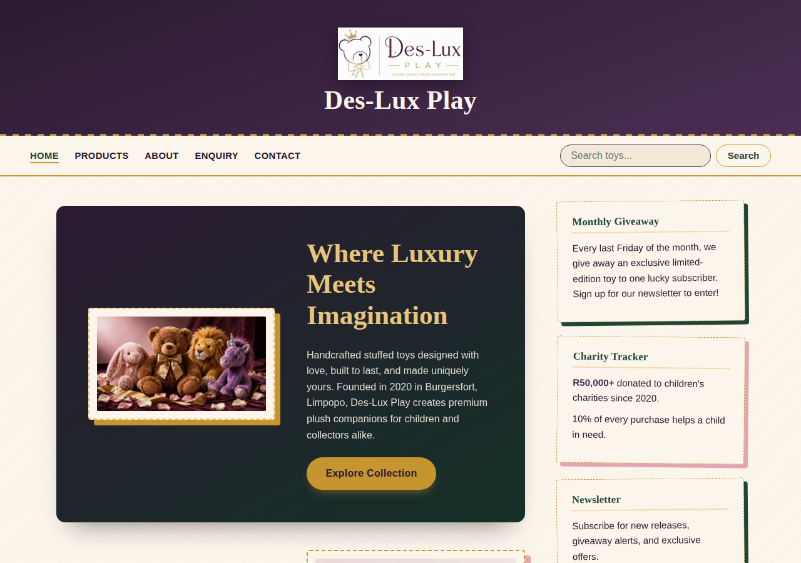
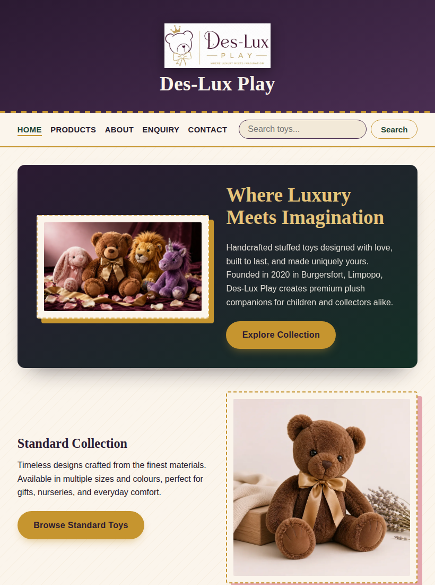
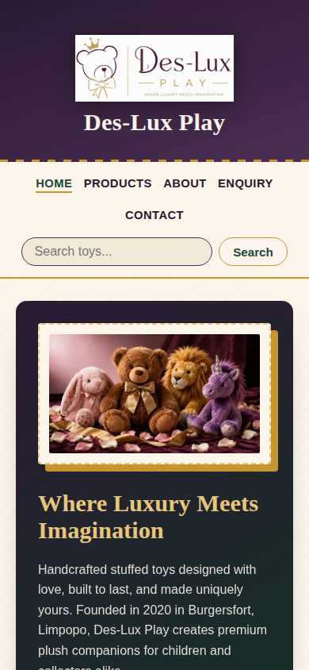
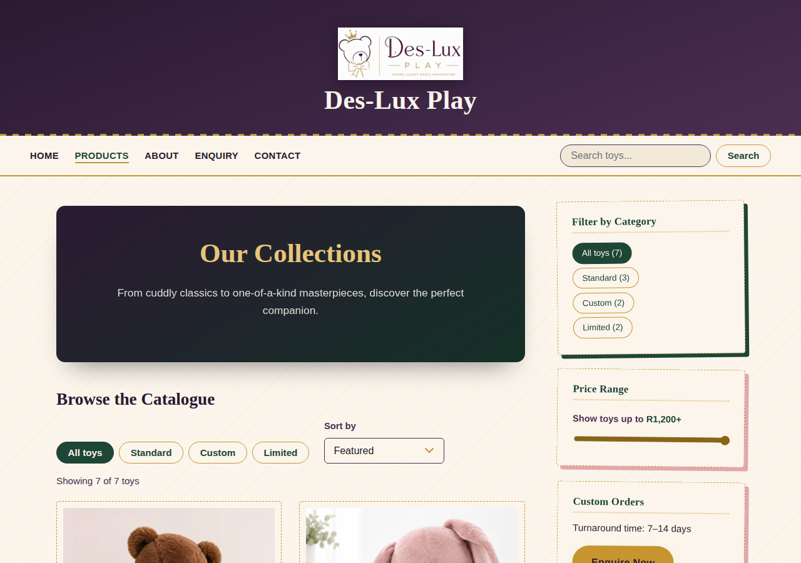
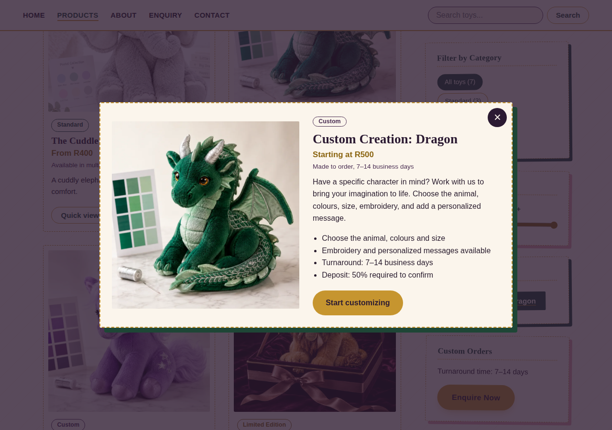
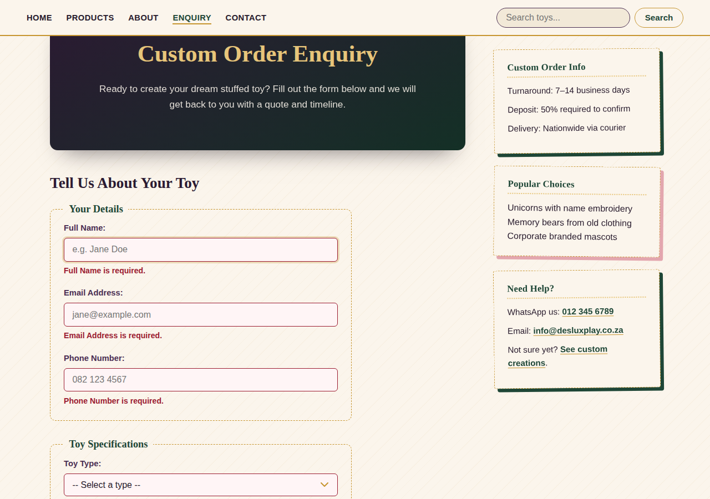

# Des-Lux Play

*Where Luxury Meets Imagination*

A five-page website for Des-Lux Play, a handcrafted luxury stuffed-toy brand founded in 2020 in Burgersfort, Limpopo, South Africa. Part 3 adds JavaScript interactivity, search-engine optimisation, validated forms and deployment on a free host.

**Live site:** `https://makwaledes.github.io/ST10525701-SEKGOBELA-MAKWALE-DES-J-Part-2/` *(replace with your final GitHub Pages address after deploying)*

---

## Pages

| File | Purpose |
|---|---|
| `index.html` | Home. Hero banner, the three collections, charity commitment, newsletter, animated charity counter. |
| `products.html` | Catalogue built by JavaScript: live search, category filter, price filter, sort, quick-view modal, and an Ordering information tabs panel. |
| `about.html` | Founder's story, mission, vision, charity partnerships, and a photo gallery (10 photos) with a lightbox. |
| `enquiry.html` | Custom-order form with validation, an instant estimate, AJAX submission, and an FAQ accordion. |
| `contact.html` | Contact form with validation and a compiled e-mail, plus an interactive Leaflet map of both stores. |
| `404.html` | Friendly page shown by GitHub Pages for broken links. |

Every page shares the same header, sticky navigation, sidebar and footer.

---

## Screenshots

Screenshots were taken in a test browser without internet access, so Google Fonts did not load and the headings show in the fallback serif. On the live site they use Fraunces and Work Sans.

### Desktop


### Tablet (below 900px)


### Mobile (below 700px)


### New in Part 3




---

## Part 3 features

### Interactive elements (`js/site.js`, `js/products.js`, `js/map.js`)

| Feature | Where | Notes |
|---|---|---|
| Accordion | `enquiry.html` FAQ | WAI-ARIA accordion pattern. Collapsed panels are `inert`, arrow keys move between questions. |
| Tabs | `products.html` "Good to Know" | WAI-ARIA tabs pattern with Left/Right/Home/End keys. |
| Modal | `products.html` quick view | Native `<dialog>`: focus trap, Esc to close, backdrop click to close. |
| Lightbox gallery | `about.html` | Previous/next buttons, arrow keys, photo counter, wraps around. |
| Interactive map | `contact.html` | Leaflet + OpenStreetMap. Markers are read from the location cards. "Show on map" buttons and a "Find my nearest store" geolocation feature. |
| Animations and transitions | all pages | Banner photograph settles into its frame on load (CSS keyframes). Accordion panels animate their height. Charity total counts up when scrolled into view (`requestAnimationFrame`). Hover and open/close transitions. All switch off under `prefers-reduced-motion`. |
| Advanced DOM manipulation | `products.js`, `forms.js` | Elements are built with a small `h()` helper, inserted through `DocumentFragment`, and updated with `replaceChildren`. One delegated click listener serves every card. `IntersectionObserver` drives the counter. Result panels use `textContent` only, so visitor input is never parsed as HTML. |

### Dynamic content (`js/products-data.js`, `js/products.js`)

The catalogue is a JavaScript array. `products.js` renders the cards and supports:

- **Search**: the search box in the header filters live on the products page. On other pages it opens `products.html?q=...`.
- **Category filter**: chips in the toolbar and links in the sidebar.
- **Price filter**: slider in the sidebar.
- **Sort**: featured, price low to high, price high to low, name.
- **Shareable URLs**: `products.html?category=limited&q=lion`.
- **Recently viewed**: the last three quick views, kept in `localStorage`.

To add a toy, copy one object in `js/products-data.js`.

### Forms (`js/forms.js`)

| | `enquiry.html` | `contact.html` |
|---|---|---|
| Purpose | Custom-order enquiry | General message |
| Fields | Name, e-mail, phone, toy type, size, colours, budget, description, needed-by date, reference image | Name, e-mail, phone (optional), message type, message |
| Result | Instant estimate (price, budget fit, availability, deposit) and an "E-mail this enquiry" button | The compiled e-mail (to, subject, body) and an "Open in my e-mail app" button |
| Recipient | `DLP.EMAIL_TO` in `js/config.js` (`info@desluxplay.co.za`) | same |

**Validation** combines HTML5 attributes (`required`, `minlength`, `maxlength`, `type`, `accept`) with JavaScript rules:

- Names: letters, spaces, hyphens, apostrophes.
- E-mail: format check.
- Phone: South African format (`082 123 4567` or `+27 82 123 4567`).
- Date: no sooner than 7 business days ahead (the shortest turnaround).
- Image: must be an image file, 2 MB or smaller.
- Message length with a live character counter.

Errors appear under each field, are linked with `aria-describedby`, mark the field `aria-invalid`, and the first bad field receives focus.

**AJAX submission** uses `fetch` to POST the form data to the Formspree URL in the form's `action`, with a "Sending..." state and error handling. Without JavaScript the same form still posts normally.

---

## SEO

### Keyword research

These are candidate keywords drawn from the brand's content and the way South African shoppers describe handmade toys. Search volumes have **not** been measured; confirm them with Google Keyword Planner or Google Trends before relying on them.

| Page | Primary keyword | Secondary keywords |
|---|---|---|
| Home | luxury handmade stuffed toys | luxury plush South Africa, handmade teddy bear Limpopo |
| Products | custom teddy bear South Africa | limited edition plush, personalised stuffed animal, buy luxury plush toys |
| About | Des-Lux Play founder | handmade toy maker Limpopo, charity stuffed toys South Africa |
| Enquiry | custom stuffed toy quote | memory bear from old clothes, embroidered name toy, personalised plush |
| Contact | toy store Burgersfort | toy shop Polokwane, Savannah Mall pop-up store |

### On-page SEO (done)

- **Title tags and meta descriptions**: unique per page, titles 29 to 54 characters, descriptions 110 to 160.
- **Headings**: exactly one `<h1>` per page, `<h2>` for sections, `<h3>` for small headings. (Part 2 used the brand name as an `<h1>` on every page and skipped `<h2>`.)
- **Images**: descriptive file names (for example `custom-emerald-dragon-plush.webp`) and descriptive `alt` text.
- **URLs**: short, lowercase, hyphenated (`products.html?category=limited`).
- **Internal linking**: calls to action and in-text links connect home, products, about, enquiry and contact; the footer repeats the full menu on every page.
- **Mobile-friendliness**: responsive layout, viewport meta tag, no sideways scrolling at 390px, touch-sized controls.
- **Open Graph and Twitter cards**: share previews with a title, description and photograph.
- **Structured data (JSON-LD)**: `Organization` and `WebSite` (with site search) on the home page, `Organization` on About, `ItemList` of `Product` on Products, `FAQPage` on Enquiry, and two `Store` entries on Contact.
- **Canonical URLs** on every page.

### Off-page SEO (actions for the owner)

These cannot be built into the code; they are the plan.

- **Backlinks**: ask the charities the 10% pledge supports to link to the site from their partner pages; submit the brand to South African parenting blogs and gift guides; list on local Limpopo business directories.
- **Social media**: the footer and Contact page link to Instagram (`@desluxplay`), and every page carries Open Graph tags so shared links show a preview. Post new "drops" with a link to `products.html?category=limited`.
- **Local SEO**: claim a Google Business Profile for each store, keep the name, address and phone identical to the Contact page, and use the `Store` structured data already on that page.

### Additional requests

| Item | Where |
|---|---|
| `robots.txt` | Allows crawling, blocks `/docs/` and `/404.html`, points to the sitemap. |
| `sitemap.xml` | Lists the five pages with `lastmod`, `changefreq` and `priority`. |
| Page speed | Images converted to WebP and resized: **16.2 MB to about 1.1 MB** in total (twelve images). Fonts load with `preconnect` and `display=swap` (the CSS `@import` was removed). Scripts use `defer`. Below-the-fold images use `loading="lazy"`; the hero image is preloaded with `fetchpriority="high"`. Every image has width and height attributes so the layout does not jump. |
| Security | See below. |

### Security

- **Content Security Policy** (`<meta http-equiv>` on every page) allows scripts and styles only from this site, plus the Leaflet CDN on the contact page and Google Fonts.
- **Subresource Integrity** hashes on the Leaflet files.
- **Input handling**: visitor text is inserted with `textContent` and `encodeURIComponent`, never as HTML. Every field has a length limit.
- **Honeypot field** on every form to catch simple bots.
- External links use `rel="noopener"`.
- GitHub Pages serves everything over HTTPS.

Note: a meta tag cannot set every security header (for example `X-Frame-Options`). GitHub Pages does not allow custom headers, so those are not possible on this host.

---

## Folder structure

```
des-lux-play/
├── index.html
├── products.html
├── about.html
├── enquiry.html
├── contact.html
├── 404.html
├── robots.txt
├── sitemap.xml
├── README.md
├── css/
│   └── style.css
├── js/
│   ├── config.js          <- form URL, e-mail recipient, estimate prices
│   ├── site.js            <- accordion, tabs, lightbox, counter, newsletter
│   ├── products-data.js   <- the catalogue
│   ├── products.js        <- search, filter, sort, modal
│   ├── forms.js           <- validation, AJAX, result panels
│   └── map.js             <- Leaflet map
├── docs/
│   └── screenshots/
└── images/
    ├── favicon.png
    ├── des-lux-play-logo.webp
    ├── luxury-handmade-stuffed-toys-hero.webp
    ├── standard-collection-chestnut-teddy-bear.webp
    ├── custom-purple-unicorn-plush.webp
    ├── custom-emerald-dragon-plush.webp
    ├── limited-edition-golden-lion-plush.webp
    ├── velvet-bunny-pastel-pink-plush.webp
    ├── cuddle-elephant-grey-plush.webp
    ├── silver-fox-limited-edition-plush.webp
    ├── des-j-sekgobela-founder-stitching.webp
    └── des-lux-play-charity-donation-children.webp
```

---

## Running it locally

No build step and no dependencies. Serve the folder over http (the map, fonts and forms need it):

```bash
python3 -m http.server 8000
```

Then visit `http://localhost:8000`.

---

## Deployment (GitHub Pages)

1. Make sure `index.html` is at the **root** of the repository (not inside a subfolder).
2. Commit and push to the `main` branch.
3. On GitHub: **Settings > Pages > Build and deployment > Source: Deploy from a branch**, branch `main`, folder `/ (root)`, then Save.
4. After a minute the site is live at `https://<username>.github.io/<repository>/`.
5. Replace the address `https://makwaledes.github.io/ST10525701-SEKGOBELA-MAKWALE-DES-J-Part-2/` with your real one in: every page's `canonical` and `og:` tags, the JSON-LD blocks, `robots.txt`, `sitemap.xml`, and the "Live site" line above.
6. Submit `sitemap.xml` in Google Search Console.

---

## Design

The stylesheet is one file, `css/style.css`, in fourteen commented sections (the thirteen from Part 2 plus Part 3 additions).

**Colour**: deep plum and forest green with warm gold and blush on a textured ivory background, as CSS custom properties on `:root`. Part 3 adds `--gold-dark` for gold text that meets contrast requirements on ivory.

**Type**: Fraunces for headings and Work Sans for body text.

**The stitching motif** continues: dashed gold borders and hard offset shadows on photographs, product cards, the map frame, dialogs and result panels.

**Layout**: a two-column grid that collapses to one column below 900px. Sections with tools, grids or forms use the `.wide` class to opt out of the Part 2 image-pair layout.

The stylesheet relies on `:has()`, supported in all current browsers.

---

## Accessibility

- Every image has descriptive alt text; the map has an accessible name and a Google Maps fallback link on each location.
- Form fields use `<label for>`, errors are announced politely, and invalid fields are marked `aria-invalid`.
- Tabs, accordion, modal and lightbox follow the WAI-ARIA patterns and work with the keyboard alone.
- Visible focus everywhere; skip link; two labelled `<nav>` landmarks.
- `prefers-reduced-motion` is respected by every animation.
- Gold text uses a darker gold for contrast.

---

## Before going live

- **Connect the forms.** Create a free form at Formspree and replace `YOUR_FORM_ID` in `js/config.js` **and** in the three `action` attributes (`enquiry.html`, `contact.html`, newsletter box in `index.html`). Until then the site runs in demo mode: forms validate and show results but send nothing, and say so.
- **Confirm the estimate prices** in `js/config.js`. Only "Custom Creations start at R500" came from the brief; the other sizes are placeholders.
- **Replace the placeholder contact details** (phone numbers, e-mail addresses, street addresses). The store map coordinates are approximate town-centre positions.
- **Confirm the Care tab text** on the products page.

---

## Changelog

### Part 3 (October 2026)

#### 1. Working through feedback from Part 2

*Lecturer feedback points are listed first; items I found myself follow.*

| Feedback received | What was changed | Files |
|---|---|---|
| *(add each point from the Part 2 feedback here, one row each)* | | |

Issues listed under "Before going live" in the Part 2 README, now resolved:

| Issue from Part 2 | Change made | Files |
|---|---|---|
| Search box was markup only | Header search is now a real GET form. On `products.html` it filters live; elsewhere it opens `products.html?q=...`. Empty searches are blocked. | all pages, `site.js`, `products.js` |
| Newsletter signup was markup only | Now a form with e-mail validation, a honeypot, AJAX submission and a status message. | `index.html`, `site.js` |
| Category filter links were `href="#"` | Links open `products.html?category=...` and filter instantly with JavaScript. Sidebar counts match the data (Standard 3, Custom 2, Limited 2). | `products.html`, `products.js` |
| Forms posted to a placeholder | Forms are now validated and sent by AJAX. The placeholder remains until a Formspree ID is added; demo mode makes this visible. | `enquiry.html`, `contact.html`, `forms.js`, `config.js` |
| Map embeds were approximations | Google iframes replaced by a Leaflet map whose markers come from coordinates in the page. Each location also links to Google Maps. | `contact.html`, `map.js` |
| Image filenames contained typos (`standdard`, `uicoron`, `fouder`) | All images renamed with descriptive names and the HTML updated. | `images/`, all pages |

Further corrections made while working through Part 2:

| Issue | Change made | Files |
|---|---|---|
| Every page used the brand name as its `<h1>` and skipped `<h2>` | One `<h1>` per page; sections `<h2>`; sidebar headings `<h3>`. Header brand is now a styled `<div>`. | all pages, `style.css` |
| Logo `width`/`height` attributes (500x150) did not match the image ratio | Corrected to 500x209. | all pages |
| Gold text failed contrast on ivory | Added `--gold-dark` and used it for gold text. | `style.css` |
| Images totalled 16.2 MB | Converted to WebP and resized (the original nine to 0.8 MB). | `images/` |
| Fonts loaded with a CSS `@import` | Moved to `<link>` with `preconnect`. | all pages, `style.css` |
| Screenshots section pointed at `screenshots/` while the folder tree said `docs/screenshots/` | Paths now match and screenshots were retaken. | `README.md`, `docs/` |

#### 2. Functionality
- Added `js/` folder: `config.js`, `site.js`, `products-data.js`, `products.js`, `forms.js`, `map.js`.
- Accordion (enquiry FAQ), tabs (products), modal (quick view), lightbox gallery (about), interactive Leaflet map (contact), count-up animation, banner entrance animation, dialog and tab transitions.
- Dynamic catalogue with search, category filter, price filter, sort, shareable URLs and recently viewed.
- `products.html` restructured: the three static sections became a generated catalogue; Custom Creations is now two entries (dragon and unicorn) using the two custom photographs from Part 2.
- The three new photographs are also in the About page gallery (now 10 photos). Added photographs for the Velvet Bunny, Cuddle Elephant and Silver Fox (`velvet-bunny-pastel-pink-plush.webp`, `cuddle-elephant-grey-plush.webp`, `silver-fox-limited-edition-plush.webp`): cropped to squares, converted to WebP, and given descriptive alt text. All seven catalogue toys now have photographs.
- Added a gallery to `about.html`, an FAQ to `enquiry.html`, and a "Find my nearest store" feature to `contact.html`.
- New CSS section 14 for all of the above.

#### 3. Forms
- `enquiry.html`: added a "Needed by" date, field hints, honeypot, hidden form name, result panel with estimate, budget fit, availability and deposit, plus an e-mail button. `?toy=` preselects the toy type from a product link.
- `contact.html`: added optional phone, a minimum message length, a character counter, and a result panel showing the compiled e-mail with an "Open in my e-mail app" button.
- Client-side validation with specific error messages, `aria-invalid`, focus on the first error, and AJAX submission with error handling.

#### 4. SEO
- Unique title and meta description per page; keywords, author, robots, canonical.
- Open Graph and Twitter card tags.
- JSON-LD structured data for the organisation, website search, products, FAQ and both stores.
- Added `robots.txt`, `sitemap.xml` and `404.html`.
- Descriptive image names, alt text kept, internal links added in body copy and the footer.

#### 5. Security and performance
- Content Security Policy, referrer policy, Subresource Integrity on Leaflet, honeypots, length limits.
- WebP images, deferred scripts, lazy loading, hero preload.

#### 6. Repository
- Site files moved to the repository root so GitHub Pages can serve `index.html`.
- README updated with Part 3 documentation, this changelog and references.

### Part 2 (September 2026)

- Wrote the complete stylesheet `css/style.css` (thirteen commented sections).
- Added explanatory comments to all five HTML files.
- Fixed fourteen markup, functionality and accessibility issues (run-together attributes, invalid image heights, bare ampersand, percentage widths on iframes, missing `enctype` on the upload form, mismatched images, `target="_self"` on external links, missing labels, skip link, `aria-current`). Full detail is in `5. Fixed mistakes and Modifications/Fixed mistakes and changes.pdf`.

---

## References

Add your access date to each entry in the format your module requires (for example, "Accessed: 26 October 2026"). Append these to your existing Part 2 list.

- Agafonkin, V. (n.d.) *Leaflet: an open-source JavaScript library for interactive maps*. Available at: https://leafletjs.com
- Google Search Central (n.d.) *SEO Starter Guide*. Available at: https://developers.google.com/search/docs/fundamentals/seo-starter-guide
- Google Search Central (n.d.) *Intro to structured data markup in Google Search*. Available at: https://developers.google.com/search/docs/appearance/structured-data/intro-structured-data
- Formspree (n.d.) *Formspree help: AJAX submission*. Available at: https://help.formspree.io
- GitHub (n.d.) *GitHub Pages documentation*. Available at: https://docs.github.com/pages
- MDN Web Docs (n.d.) *The Dialog element*. Available at: https://developer.mozilla.org/en-US/docs/Web/HTML/Element/dialog
- MDN Web Docs (n.d.) *Content Security Policy (CSP)*. Available at: https://developer.mozilla.org/en-US/docs/Web/HTTP/CSP
- OpenStreetMap contributors (n.d.) *OpenStreetMap copyright and license*. Available at: https://www.openstreetmap.org/copyright
- Schema.org (n.d.) *Schema.org*. Available at: https://schema.org
- Sitemaps.org (n.d.) *Sitemaps XML format*. Available at: https://www.sitemaps.org/protocol.html
- W3C Web Accessibility Initiative (n.d.) *ARIA Authoring Practices Guide: Tabs and Accordion patterns*. Available at: https://www.w3.org/WAI/ARIA/apg/
- web.dev (n.d.) *Web Vitals*. Available at: https://web.dev/vitals/

---

© 2026 Des-Lux Play. All rights reserved.
